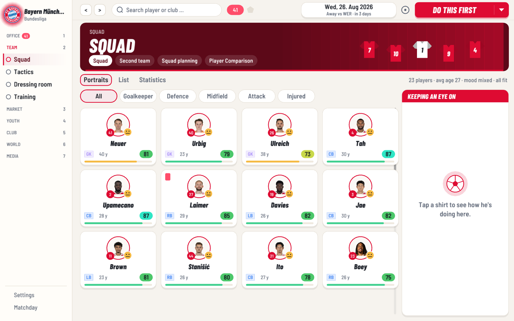
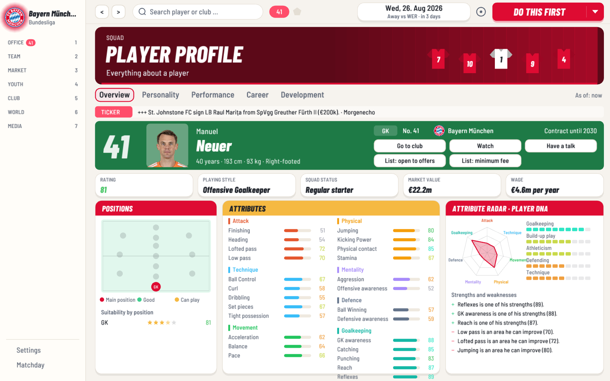
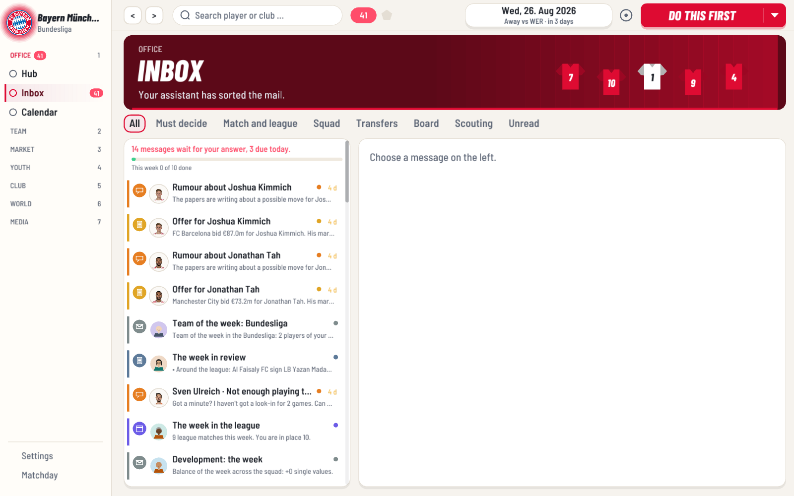

# PES M

**A football manager that uses Football Life 2027 as its match engine.**

<p align="center">
  
  
  
  
  
  
</p>

> Screenshots taken with the author's own FL27 world (FL Mod Studio Gigapack). Crests, player photos and stadium pictures are read at runtime from the player's own game install; they are **not** shipped in this repository.

> Unofficial fan project. Not affiliated with Konami or the Football Life team. This repository contains **no** game files, crests, photos or databases. You need your own copy of FL27.

---


PES M started as a small companion app for Master League. It is now a football manager of its own: you run a club over many seasons, and the matches themselves are played in Football Life 2027.

### What PES M does

- **Careers over many seasons** on your FL27 world (leagues, clubs and squads are read straight from the pesdb). One day is one step.
- **Squad and tactics:** line-up, roles and instructions, set pieces, opponent reports, training, medical, form, development per ability.
- **Market:** transfers with negotiations, agents with their own goals, clauses, loans, scouting, shortlist, staff market.
- **Club:** board and objectives, finances, stadium and facilities, sponsors, coaching staff, academy, reserve team, partner clubs.
- **World:** leagues, cups and European competitions with real rules (play-offs, relegation), tables, rankings, club history, world map.
- **People and media:** inbox, player talks, dressing room, press conferences, newspaper, fans, stories that unfold over weeks.
- **Two languages** (English, German) and two themes (light "Sonntag", dark "Flutlicht").

### FL27 as the match engine

On match day you can simulate the match in PES M (with a live ticker) or play it yourself in FL27:

- PES M writes squads, transfers and **both line-ups** into your career's own copy of the pesdb and mounts it through Sider.
- It sets the **competition** (scoreboard, walk-out, ball), the home team's **stadium** and the **weather**.
- FL27 starts through Lutris and **boots straight into the match**, skipping the main menu and team selection, with the right kits. (Confirmed in the game; the button in PES M is being wired up.)
- After the match PES M reads the **real statistics** (goals, assists, shots, passes, cards, saves …) from the game's memory and rates the players from them. Reading only.
- Goes well with the [PESM Coaching Zone](https://github.com/FabianZettl/pesm-coaching-zone): live stats on your phone while you play.

PES M backs up the originals before it changes anything in your game folder; "Rückbau" in the settings restores them. The Sider modules and flow files for the direct start are **not** in this repository, because they build on files from the game and from mods.

**Status:** under active development. Tested on Linux (Proton via Lutris). Controller assignment in the direct start and goal celebrations are being finished.

### Build

```sh
cargo build --release
./target/release/pesm
```

Without FL27, PES M starts with a small built-in sample world (real clubs, made-up player names). Tests: `PESM_KARRIEREN=$(mktemp -d) cargo test --release`.

Rules and numbers: [MECHANICS.md](MECHANICS.md). Sources and licences: [CREDITS.md](CREDITS.md).

## License

MIT, see [LICENSE](LICENSE). Fonts: SIL Open Font License. Sounds: CC0.
