<p align="center"></p>

# CalcioM – Calcio Management

**A football manager that uses Football Life 2027 as its match engine.**

> [!NOTE]
> **CalcioM (Calcio Management), formerly PES M.** Version 0.5 is the first stable release (current: 0.5.1). Downloads for Linux and Windows are on the [Releases page](https://github.com/FabianZettl/calciom/releases) (Windows is not tested on a real PC yet). Or build it yourself (see [Build](#build)).
> **Coming from PES M?** Unpack CalcioM into the same folder and start it: your saves move over by themselves ([details](docs/GETTING-STARTED.md#upgrading-from-pes-m)). Old PES M versions show the update notice too (the old repository link forwards here).
> **New here?** Read the [Getting started guide](docs/GETTING-STARTED.md): from the first launch to a career and your first FL27 match, for Windows and Linux.
> CalcioM never touches your original FL27 database: it always works on **its own copy of the database in a separate LiveCPK folder** per career.

<p align="center">
  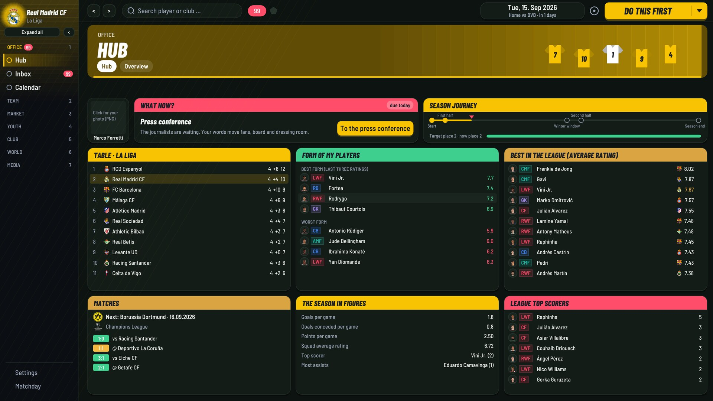
  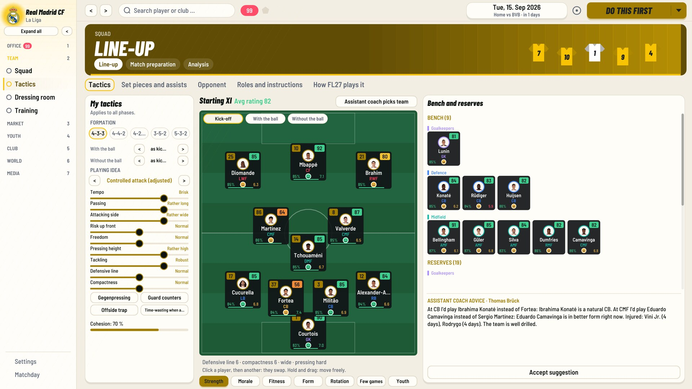
  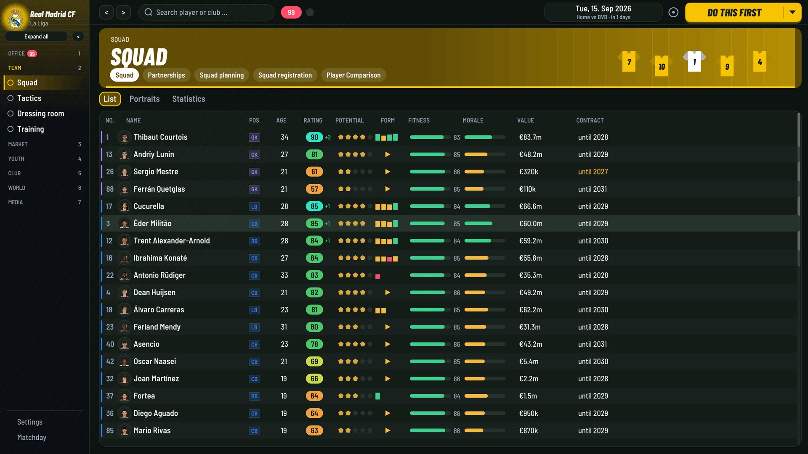
  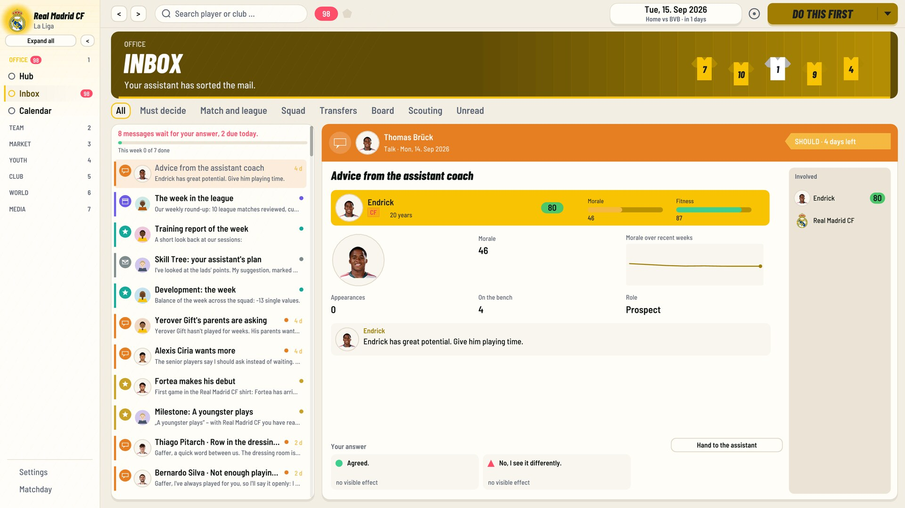
  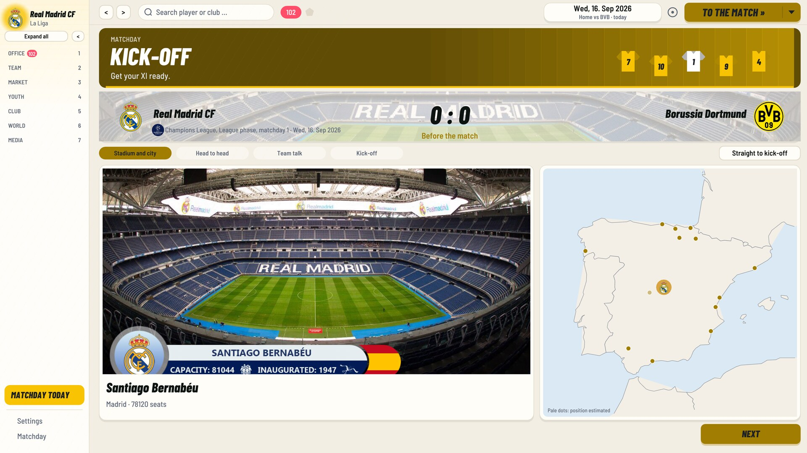
  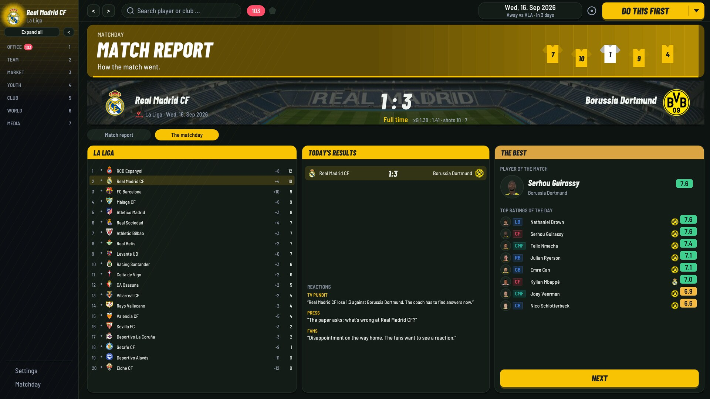
  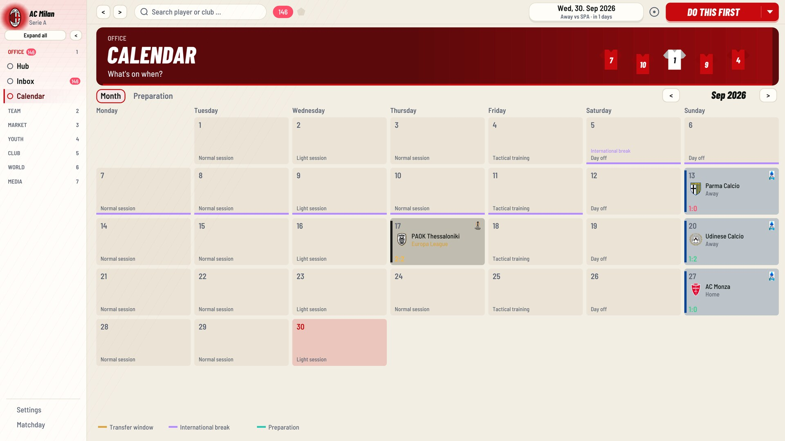
  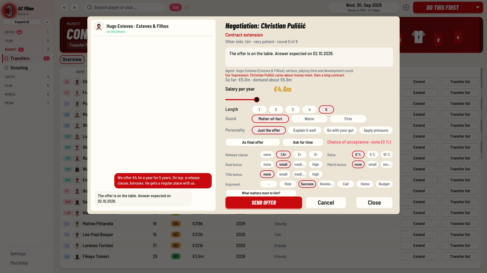
  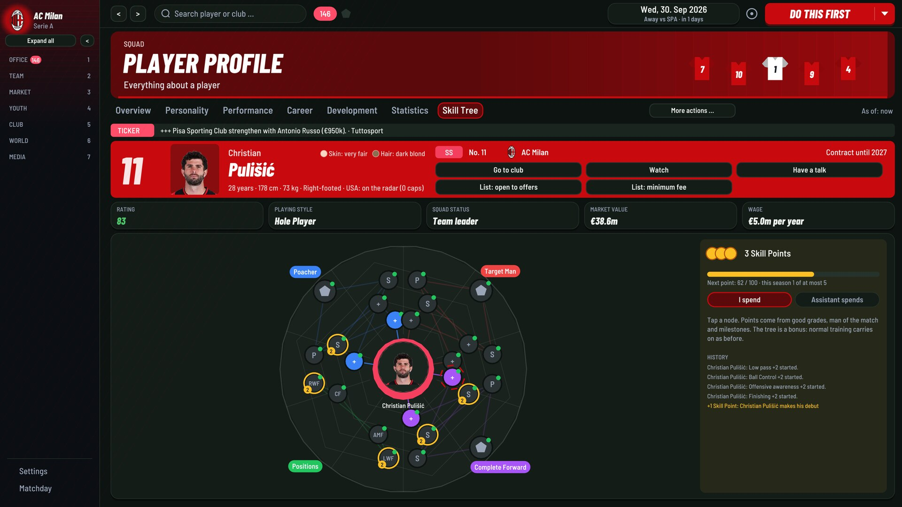
  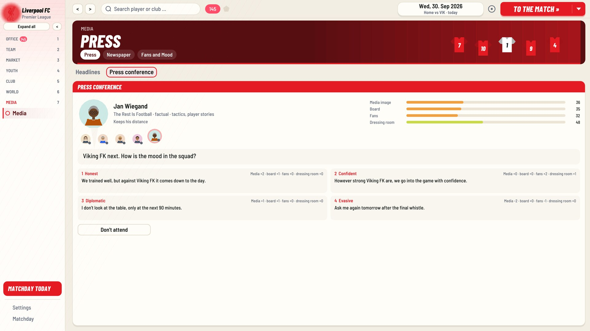
  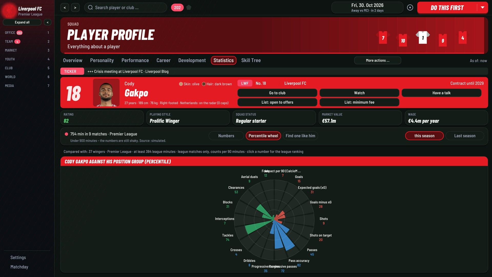
</p>

> Screenshots of CalcioM 0.5.0 from three test careers (Real Madrid, AC Milan, Liverpool), light and dark theme. Crests, player photos and stadium pictures are read at runtime from the player's own game install; they are **not** shipped in this repository.

> Unofficial fan project. Not affiliated with Konami or the Football Life team. This repository contains **no** game files, crests, photos or databases. You need your own copy of FL27.

---


CalcioM (formerly PES M) started as a small companion app for Master League. It is now a football manager of its own: you run a club over many seasons, and the matches themselves are played in Football Life 2027.

### What CalcioM does

- **Careers over many seasons** on your FL27 world (leagues, clubs and squads are read straight from the pesdb). One day is one step.
- **Start from your Master League save:** pick one of the saves CalcioM finds (or "Import ML save…") in the world step; it takes over the date, squads, contracts, abilities, form, injuries, tables and fixtures of an FL27 Master League save (read only, tested with copies of real saves).
- **Squad and tactics:** line-up, roles and instructions, set pieces, opponent reports, training, medical, form, development per ability.
- **Market:** transfers with negotiations, agents with their own goals, clauses, loans, scouting, shortlist, staff market.
- **Club:** board and objectives, finances, stadium and facilities, sponsors, coaching staff, academy, reserve team, partner clubs.
- **World:** leagues, cups and European competitions with real rules (play-offs, relegation), tables, rankings, club history, world map.
- **People and media:** inbox, player talks, dressing room, press conferences, newspaper, fans, stories that unfold over weeks.
- **Four languages** (English, German, Spanish, French) and two themes (light "Sonntag", dark "Flutlicht").

### FL27 as the match engine

On match day you can simulate the match in CalcioM (with a live ticker) or play it yourself in FL27:

- CalcioM writes squads, transfers and **both line-ups** into your career's own copy of the pesdb and mounts it through Sider.
- It sets the **competition** (scoreboard, walk-out, ball), the home team's **stadium** and the **weather**.
- FL27 starts through Lutris and **boots straight into the match**, skipping the main menu and team selection, with the right kits. Switch it on under *Settings › Football Life 2027 › Direct start*; CalcioM builds the files it needs from your own game install.
- **Quick start:** FL27 stays open between matches. After the final whistle it waits at the side selection; on the next match day CalcioM loads the next fixture, your line-up, stadium and weather into the waiting game and brings it to the front.
- After the match CalcioM reads the **real statistics** (goals, assists, shots, passes, cards, saves …) from the game's memory and rates the players from them. Reading only.
- Goes well with the [PESM Coaching Zone](https://github.com/FabianZettl/pesm-coaching-zone): live stats on your phone while you play.

CalcioM backs up the originals before it changes anything in your game folder; "Rückbau" in the settings restores them. The flow files for the direct start are **not** in this repository: CalcioM builds them on your PC from your own game files.

**Status:** stable (0.5), still actively developed. Tested on Linux (Proton via Lutris); Windows is not tested on a real PC yet.

### Build

```sh
cargo build --release
./target/release/calciom
```

Without FL27, CalcioM starts with a small built-in sample world (real clubs, made-up player names). Tests: `CALCIOM_KARRIEREN=$(mktemp -d) cargo test --release`.

Rules and numbers: [MECHANICS.md](MECHANICS.md). Sources and licences: [CREDITS.md](CREDITS.md).

Thanks to [BlankState222](https://github.com/BlankState222) for the ideas behind the two-legged ties and start-stamina FL27 modules.

**Start fitness in FL27 (optional):** install BlankState222's `start_stamina` module yourself from [github.com/BlankState222/FL27---siders](https://github.com/BlankState222/FL27---siders) and list it in `sider.ini` directly below the CalcioM-LivePatch module (`pesm-livepatch.lua`). Then switch on *Settings › Football Life 2027 › Write start fitness for start_stamina*: before every match CalcioM writes `SiderAddons/modules/start_stamina.txt` with the fitness of both squads. All credit for the module goes to BlankState222.

## License

MIT, see [LICENSE](LICENSE). Fonts: SIL Open Font License. Sounds: CC0.
