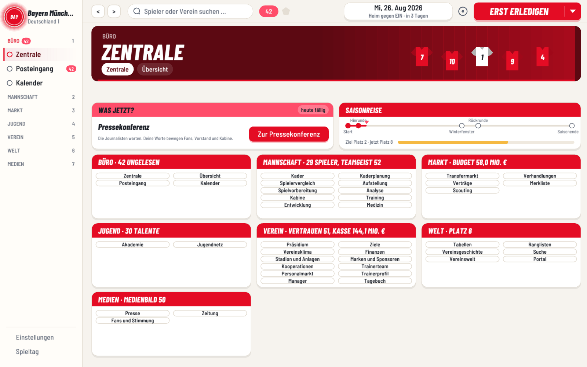
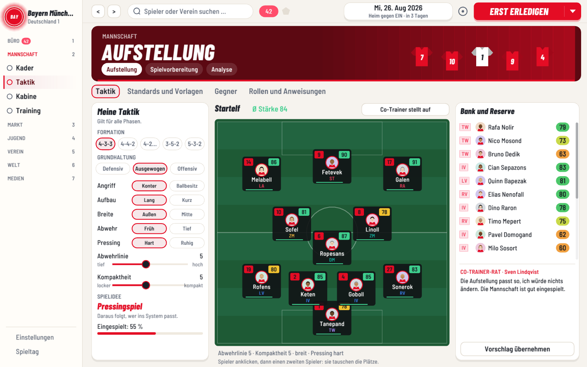
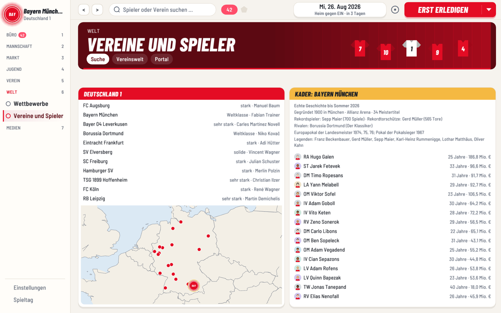
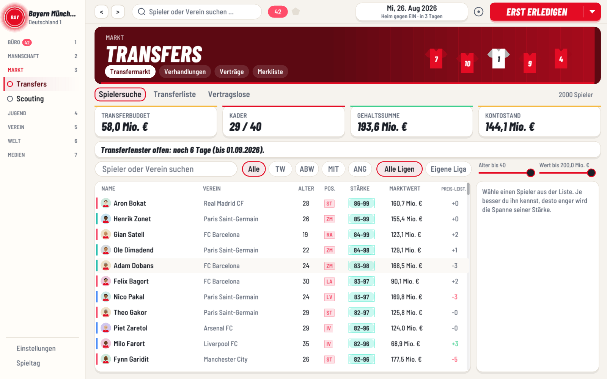

# PES M

**Ein Fußballmanager, der Football Life 2027 als Match-Engine benutzt.**
**A football manager that uses Football Life 2027 as its match engine.**

[Deutsch](#deutsch) · [English](#english)

<p align="center">
  
  
  
  
  
  
</p>

> Die Bilder zeigen die eingebaute Beispielwelt: Vereine echt, Spielernamen erfunden, keine Wappen oder Fotos aus dem Spiel.
> The screenshots show the built-in sample world: real clubs, made-up player names, no crests or photos from the game.

> Inoffizielles Fan-Projekt. Nicht verbunden mit Konami oder dem Football-Life-Team. Dieses Repository enthält **keine** Spieldateien, Wappen, Fotos oder Datenbanken. Du brauchst dein eigenes FL27.
> Unofficial fan project. Not affiliated with Konami or the Football Life team. This repository contains **no** game files, crests, photos or databases. You need your own copy of FL27.

---

## Deutsch

PES M hat als kleine Begleit-App zur Meisterliga angefangen. Inzwischen ist es ein eigener Fußballmanager: Du führst einen Verein über viele Saisons, und die Spiele selbst laufen in Football Life 2027.

### Was PES M kann

- **Karriere über viele Saisons** auf der Welt deines FL27 (Ligen, Vereine, Kader werden direkt aus der pesdb gelesen). Ein Tag ist ein Schritt.
- **Kader und Taktik:** Aufstellung, Rollen und Anweisungen, Standards, Gegneranalyse, Training, Medizin, Form, Entwicklung je Fähigkeit.
- **Markt:** Transfers mit Verhandlungen, Beratern mit eigenen Zielen, Klauseln, Leihen, Scouting, Merkliste, Personalmarkt.
- **Verein:** Präsidium und Ziele, Finanzen, Stadion und Anlagen, Sponsoren, Trainerteam, Akademie, zweite Mannschaft, Kooperationen.
- **Welt:** Ligen, Pokale und Europapokale mit echten Regeln (Play-offs, Relegation), Tabellen, Ranglisten, Vereinsgeschichte, Weltkarte.
- **Menschen und Medien:** Posteingang, Spielergespräche, Kabine, Pressekonferenzen, Zeitung, Fans, Geschichten, die sich über Wochen entwickeln.
- **Zwei Sprachen** (Deutsch, Englisch) und zwei Designs (hell „Sonntag“, dunkel „Flutlicht“).

### FL27 als Match-Engine

Am Spieltag kannst du das Spiel in PES M simulieren (mit Live-Ticker) oder in FL27 selbst spielen:

- PES M schreibt die Kader, Wechsel und **beide Aufstellungen** in eine eigene pesdb-Kopie deiner Karriere und hängt sie über Sider ein.
- Es legt **Wettbewerb** (Scoreboard, Einlauf, Ball), **Stadion** des Heimteams und **Wetter** fest.
- FL27 startet über Lutris und **bootet direkt in die Partie**, ohne Hauptmenü und Teamwahl, mit richtigen Trikots. (Im Spiel bestätigt; der Knopf in PES M wird gerade angeschlossen.)
- Nach dem Spiel liest PES M die **echten Statistiken** (Tore, Vorlagen, Schüsse, Pässe, Karten, Paraden …) aus dem Speicher des Spiels und berechnet daraus die Spielernoten. Das Lesen ist rein lesend.
- Dazu passt die [PESM Coaching Zone](https://github.com/FabianZettl/pesm-coaching-zone): Live-Statistiken aufs Handy während du spielst.

Vor jeder Änderung an deinem Spielordner sichert PES M die Originale; „Rückbau“ in den Einstellungen stellt alles wieder her. Die Sider-Module und Ablaufdateien für den Direktstart liegen **nicht** in diesem Repository, weil sie auf Dateien aus dem Spiel und aus Mods aufbauen.

**Stand:** in aktiver Entwicklung. Getestet unter Linux (Proton über Lutris). Steuerung per Controller im Direktstart und Torjubel werden gerade fertig gemacht.

### Bauen

```sh
cargo build --release
./target/release/pesm
```

Ohne FL27 startet PES M mit einer kleinen Beispielwelt (Vereine echt, Spielernamen erfunden). Tests: `PESM_KARRIEREN=$(mktemp -d) cargo test --release`.

Regeln und Zahlen: [MECHANICS.md](MECHANICS.md). Quellen und Lizenzen: [CREDITS.md](CREDITS.md).

---

## English

PES M started as a small companion app for Master League. It is now a football manager of its own: you run a club over many seasons, and the matches themselves are played in Football Life 2027.

### What PES M does

- **Careers over many seasons** on your FL27 world (leagues, clubs and squads are read straight from the pesdb). One day is one step.
- **Squad and tactics:** line-up, roles and instructions, set pieces, opponent reports, training, medical, form, development per ability.
- **Market:** transfers with negotiations, agents with their own goals, clauses, loans, scouting, shortlist, staff market.
- **Club:** board and objectives, finances, stadium and facilities, sponsors, coaching staff, academy, reserve team, partner clubs.
- **World:** leagues, cups and European competitions with real rules (play-offs, relegation), tables, rankings, club history, world map.
- **People and media:** inbox, player talks, dressing room, press conferences, newspaper, fans, stories that unfold over weeks.
- **Two languages** (German, English) and two themes (light "Sonntag", dark "Flutlicht").

### FL27 as the match engine

On match day you can simulate the match in PES M (with a live ticker) or play it yourself in FL27:

- PES M writes squads, transfers and **both line-ups** into your career's own copy of the pesdb and mounts it through Sider.
- It sets the **competition** (scoreboard, walk-out, ball), the home team's **stadium** and the **weather**.
- FL27 starts through Lutris and **boots straight into the match**, skipping the main menu and team selection, with the right kits. (Confirmed in the game; the button in PES M is being wired up.)
- After the match PES M reads the **real statistics** (goals, assists, shots, passes, cards, saves …) from the game's memory and rates the players from them. Reading only.
- Goes well with the [PESM Coaching Zone](https://github.com/FabianZettl/pesm-coaching-zone): live stats on your phone while you play.

PES M backs up the originals before it changes anything in your game folder; "Rückbau" in the settings restores them. The Sider modules and flow files for the direct start are **not** in this repository, because they build on files from the game and from mods.

**Status:** under active development. Tested on Linux (Proton via Lutris). Controller assignment in the direct start and goal celebrations are being finished.

### Build

```sh
cargo build --release
./target/release/pesm
```

Without FL27, PES M starts with a small sample world (real clubs, made-up player names). Tests: `PESM_KARRIEREN=$(mktemp -d) cargo test --release`.

Rules and numbers: [MECHANICS.md](MECHANICS.md). Sources and licences: [CREDITS.md](CREDITS.md).

## License

MIT, see [LICENSE](LICENSE). Fonts: SIL Open Font License. Sounds: CC0.
